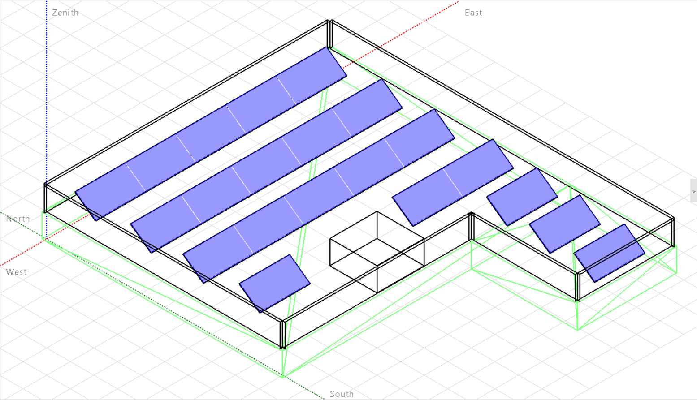

# Rooftop PV Performance and Shading Analysis

A renewable energy coursework project by **Pouya Asghari**, using **TRNSYS** to model photovoltaic electrical behavior and annual performance, and **PVsyst** to evaluate rooftop layouts and shading in Tehran.



## Objectives

- Model I–V curves at irradiance levels of 600, 800, and 1000 W/m² and compare them with the module catalog.
- Examine annual temperature, irradiance, and PV power using Tehran weather data.
- Calculate row spacing and obstacle clearance, and compare landscape and portrait panel layouts in PVsyst.

## Methods

The report uses the VSUN450-144BMH module specification for the TRNSYS analysis. Its rooftop study combines geometric shadow calculations with a three-dimensional PVsyst shading scene. Native simulation projects, decks, saved outputs, screenshots, the supplied module catalog, and a PVsyst exported report are included.

## Results and design stages

| Item | Source value | Scope |
| --- | ---: | --- |
| Hand-drawn layout | 17 panels | Narrative layout study |
| PVsyst scene discussed in report | 21 panels | Narrative design stage |
| Exported PVsyst report | 16 modules, 7.20 kWp DC | Separate saved variant |
| Inverter in exported report | 6 kW AC | Huawei SUN2000-6KTL-L1 |
| Exported annual grid energy | 12,420.28 kWh/year | Simulated 16-module variant |
| Exported performance ratio | 81.55% | Same exported variant |
| Exported annual near-shading irradiance loss | 2.38% | Same exported variant |

The panel counts are not presented as one reconciled final design. The mixed portrait/landscape arrangement is also discussed, but its final total is not established here. Selected clear-day hours without shading do not imply zero annual shading losses.

The TRNSYS period-average output peaks near 128.25 W using 720-hour blocks. Those blocks are not exact calendar months. Average power and energy yield are different quantities. The report's editorial appendix explains the spacing-equation sign issue, weather dependencies, and additional model checks.

## Files

| Path | Contents |
| --- | --- |
| [report/main.pdf](report/main.pdf) | Typeset English report with separate editorial review |
| [report/main.tex](report/main.tex) | Editable LaTeX source |
| `report/figures/` | Original report figures and PNG versions for compilation |
| [report/BUILD.md](report/BUILD.md) | LaTeX build instructions |
| `trnsys/TRNSYS_Files/` | Original Simulation Studio projects, decks, parameter files, logs, listings, and outputs |
| `trnsys/` | Original standalone plots and period-average output table |
| `pvsyst/Files/` | Original landscape and portrait project backup ZIPs |
| [PVsyst exported report](pvsyst/HW1_d_Project-Report.pdf) | Original eight-page simulation report |
| [Module catalog](docs/PV_Catalogue.pdf) | Supplied manufacturer catalog |
| [docs/RUNNING.md](docs/RUNNING.md) | Software requirements and reproduction workflow |
| [code/README.md](code/README.md) | Adding separately stored analysis scripts |

## Requirements and reproduction

Use compatible TRNSYS and PVsyst installations. TRNSYS paths reference a TRNSYS18 installation; the exported PVsyst report records version 7.4.8. Exact component-library versions for the original TRNSYS environment were not recorded.

TRNSYS models reference the external Tehran TMY2 file `IR-Teheran-407540.tm2`, which is not supplied as a standalone file. Update the absolute Windows data and output paths in a working copy. Each PVsyst backup includes project, variant, and MET weather files; restore the two backups separately because their internal filenames overlap.

The native simulations have not been rerun during repository preparation. See the [running guide](docs/RUNNING.md) before using or modifying the archived models.

## Build the report

Upload the package ZIP to Overleaf, select `report/main.tex`, and use pdfLaTeX. Alternatively, run from the repository root:

```bash
cd report
pdflatex -interaction=nonstopmode -halt-on-error main.tex
pdflatex -interaction=nonstopmode -halt-on-error main.tex
```

Only `main.tex` and the `figures/` folder are needed for report compilation. No custom fonts or bibliography database are required.

## Limitations

The historical report and source files are preserved. The English report contains a separate review of differences between design stages, sign conventions, averaging periods, and electrical parameters. The simulation trends and exported results are not independent experimental validation, and no global optimality claim is made for the rooftop layout.

## Academic context

Renewable Energies course, School of Mechanical Engineering, College of Engineering, University of Tehran. Adviser: Dr. Pouria Ahmadi. Original report date: 1404.08.03 (Iranian calendar).

The source report was already in English. LaTeX conversion, documentation, and separate editorial notes were prepared with AI assistance. Native project files and original figures were retained; PNG copies of original raster figures support LaTeX compilation.

## License

No license has been selected. Add one after deciding the intended reuse permissions. Third-party software, weather data, and catalog material retain their own terms.
